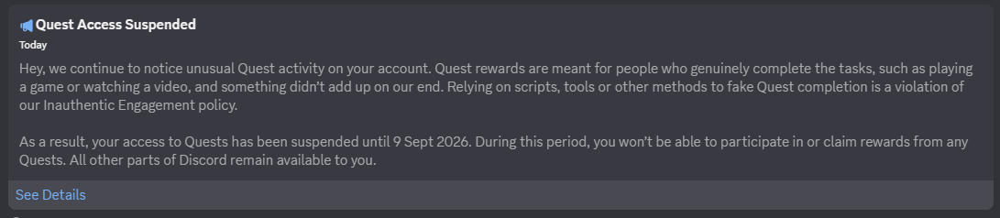

# Meowssion

> **Discord Quests Automation & Orbs Rewards Management Plugin for BetterDiscord.**  
> Automate quests, track your Orbs in real time, and simulate 3-day Nitro Credit redemptions safely.

> [!CAUTION]
> As of April 7th 2026, Discord has expressed their intent to crack down on automating quest completion.
>
> Some users have received the following system message:
>
> 
>
> Use the script at your own risk. You most likely WILL get flagged by doing so. [Learn more](https://support.discord.com/hc/en-us/articles/22225719947543-Discord-Quests-FAQ)

Created by **Miau** ([@lMiauuu](https://github.com/lMiauuu)).

---

## Table of Contents
- [Overview](#overview)
- [Key Features (v1.1.0)](#key-features-v110)
- [Anti-Ban & Security Model](#anti-ban--security-model)
- [Installation](#installation)
- [License & Credits](#license--credits)

---

## Overview
**Meowssion** is a lightweight, high-performance BetterDiscord plugin designed to manage and complete Discord Quests automatically in the background, monitor accumulated Orbs rewards in real time, and simulate Nitro Credit redemptions without tedious manual effort.

## Key Features (v1.1.0)
- **All Quest Types Supported:** Automates video-watching, desktop gaming spoofing, desktop stream quests, and voice channel activities.
- **Batch & Individual Execution:** Select specific quests or start all pending automatable quests with a single click.
- **Background Auto-Quest Mode:** Periodically scans for newly dropped quests and executes them quietly in the background without user intervention.
- **Real-Time Orbs Tracker (New in v1.1.0):**
  - **Earned Orbs:** Live total of Orbs earned from completed quests.
  - **Pending Orbs:** Projected Orbs available to be claimed across all active pending quests.
  - **Real Balance Resolution:** Multi-layered detection retrieving the user's actual Discord wallet balance (e.g. `148,050` Orbs) directly via internal Discord APIs, Webpack stores, and DOM inspection.
- **Nitro Credit • Orbs Shop Tab (New in v1.1.0):**
  - Interactive simulator for the official **3-Day Nitro Credit** item (`1,400` Orbs each).
  - Quantity controls (`-`, `+`, direct numeric input, and `MAX` shortcut).
  - Instant calculation of total stacked days (`+{qty * 3} days of Nitro`), total Orbs cost, remaining balance, and pending quests coverage.
  - **Wallet Synchronization:** Allows manual adjustment, local redemption logging, or direct synchronization with your actual Discord wallet ledger.
- **Sleek Multi-Theme Interface:** Includes 4 visual themes (`Midnight`, `Dark`, `Glass`, and `Discord`) designed for seamless Discord integration.

## Anti-Ban & Security Model
Meowssion is built with account safety as the #1 priority:
- Quests are progressed through sanctioned internal store dispatches and heartbeat events.
- **No Automated Purchase Loops:** Discord strictly requires interactive human challenge validation (hCaptcha/Arkose) on billing/shop checkout endpoints. Meowssion does **not** perform automated POST request loops against shop checkout endpoints, completely preventing account flags or bans.
- **Safe Guided Navigation:** The *"Open Discord Orbs Shop to Redeem"* action closes the modal, smoothly navigates via Discord's internal router to the official `/shop` or `/quest-home` page, and guides the user to complete redemption manually and securely.

## Installation
1. Download [`Meowssion.plugin.js`](Meowssion.plugin.js).
2. Move the file into your BetterDiscord plugins folder:
   - **Windows:** `%appdata%\BetterDiscord\plugins`
   - *Or open Discord Settings > BetterDiscord > Plugins > Open Plugins Folder.*
3. Enable **Meowssion** in the plugins list.
4. Click the cat icon in Discord's top title bar to open the manager.

---

## License & Credits

### License
This project is licensed under the **GNU General Public License v3.0 (GPL-3.0)**.  
See the [`LICENSE`](LICENSE) file for the full license text.

### Authorship & Acknowledgements
- **Miau ([@lMiauuu](https://github.com/lMiauuu)):**  
  Architecture, UI/UX design, visual themes, Orbs management, and Nitro Credit simulator.
- **@aamiaa ([CompleteDiscordQuest Gist](https://gist.github.com/aamiaa/204cd9d42013ded9faf646fae7f89fbb)):**  
  Technical reference for Discord Quests internal store spoofing logic under GPL-3.0.
